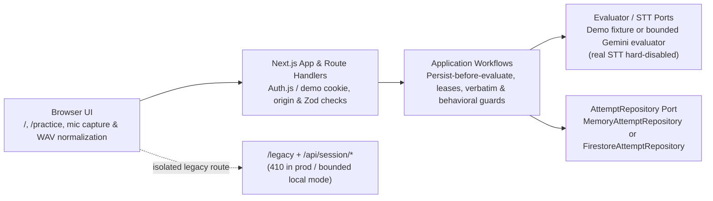
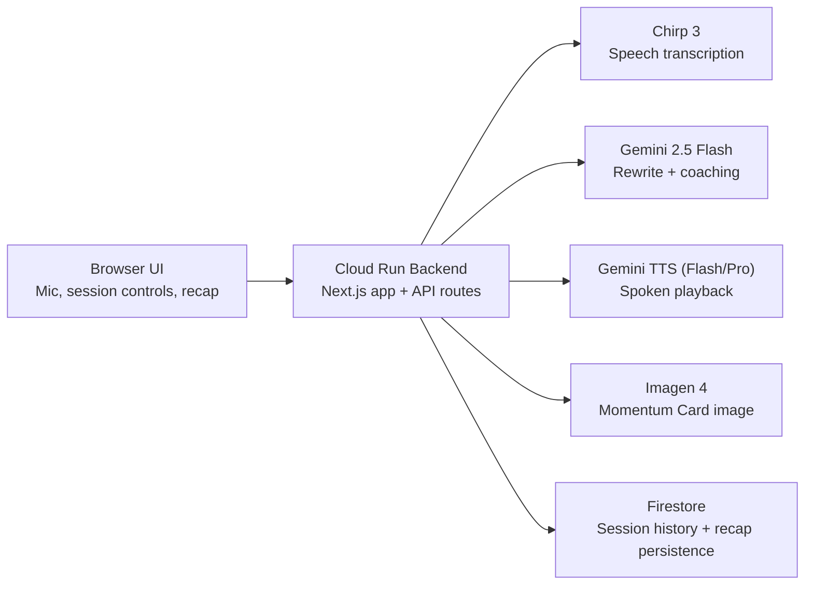

# Echo Coach Architecture

## Current Reconstructed Architecture (Modular Monolith)

The `reconstruction` branch builds a modular monolith inside a single Next.js / TypeScript application (`/` home, `/practice` workspace, `/legacy` preserved prototype).

### Layering and Dependency Rule

- **`src/domain/`**: Pure interview and audio contracts (`InterviewQuestion`, `AnswerAttempt`, `AttemptRecord`, canonical 16 kHz mono PCM WAV encoding/validation). No React, Next.js, Google SDK, or database imports.
- **`src/application/`**: Use-case workflows (`submitPracticeAttempt`, `evaluateAttempt`, `resolveQuestionSeed`, `TranscriptionReplayCache`) and ports (`AttemptRepository`, `AnswerEvaluator`, `AudioTranscriber`).
- **`src/infrastructure/`**: Capability adapters and runtime boundaries:
  - **Auth & origin:** Auth.js v5 Google OAuth (`src/auth.ts`), verified-email allowlist + owner scoping (`practice-access.ts`), canonical write-origin guards (`canonical-origin.ts`), and `src/proxy.ts` returning `410` on legacy real-mode APIs in production and bounded local modes.
  - **Evaluators & STT:** `DemoPracticeEvaluator`, bounded `GeminiPracticeEvaluator` (`@google/genai`, structured JSON output, verbatim excerpt & behavioral guardrails), and `DemoAudioTranscriber` (real transcription remains hard-disabled in `transcription-runtime.ts`).
  - **Persistence:** `MemoryAttemptRepository` (demo) and `FirestoreAttemptRepository` (transactional attempt creation, evaluation leases, daily budget reservation, cursor pagination).
- **`src/features/practice/` & `src/app/`**: Client workspace, retry comparison, 1-depth follow-up flow, browser audio normalization (`VoiceAnswerPanel` / `useVoiceRecording`), and thin API route handlers (`/api/practice/*`).

### Runtime & Verification Status

- **Implemented & locally tested:** Demo mode (signed cookie + server memory), Auth.js cookie/allowlist validation (synthetic integration tests), bounded local Gemini coaching smoke path, and B1b demo-only WAV validation/replay cache.
- **Unverified / upcoming:** Live Google OAuth sign-in, live `FirestoreAttemptRepository` / Cloud Run deployment, real speech transcription, and genuine Gemini Live interviewing.

---

## Historical Submission Prototype (Original `/legacy` Flow)

Preserved from the initial contest submission (implemented at `/legacy` and `/session/[id]`):

### Notes (Original Prototype)

- `Browser UI` captures microphone input and renders the coaching and recap experience.
- `Cloud Run Backend` hosts the Next.js app and orchestrates the Google model stack.
- `Chirp 3` handles speech transcription.
- `Gemini 2.5 Flash` rewrites the answer and returns coaching output.
- `Gemini TTS` handles spoken playback with model fallback between Flash and Pro.
- `Imagen 4` generates the Momentum Card recap image.
- `Firestore` stores persisted session history and recap data.
