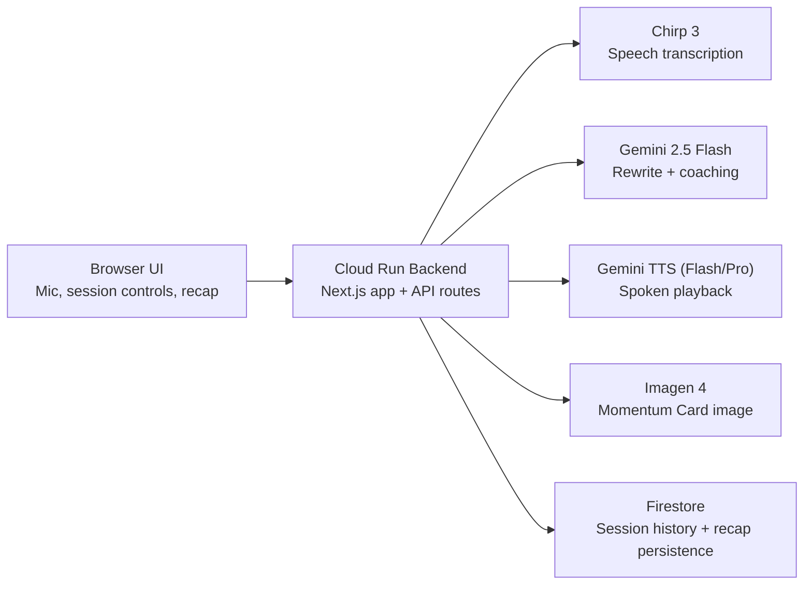

# Echo Coach Architecture

## Submission Diagram

## Notes

- `Browser UI` captures microphone input and renders the coaching and recap experience.
- `Cloud Run Backend` hosts the Next.js app and orchestrates the Google model stack.
- `Chirp 3` handles speech transcription.
- `Gemini 2.5 Flash` rewrites the answer and returns coaching output.
- `Gemini TTS` handles spoken playback with model fallback between Flash and Pro.
- `Imagen 4` generates the Momentum Card recap image.
- `Firestore` stores persisted session history and recap data.
